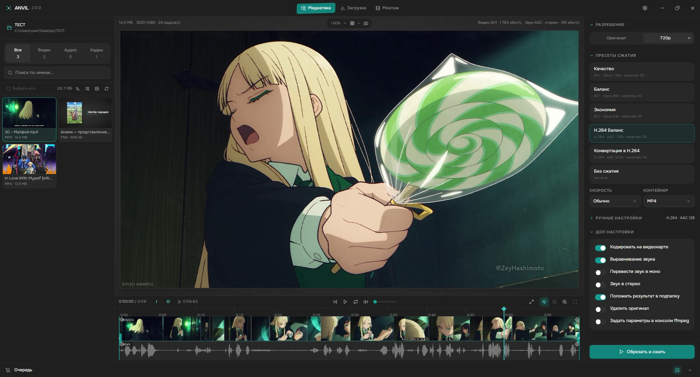
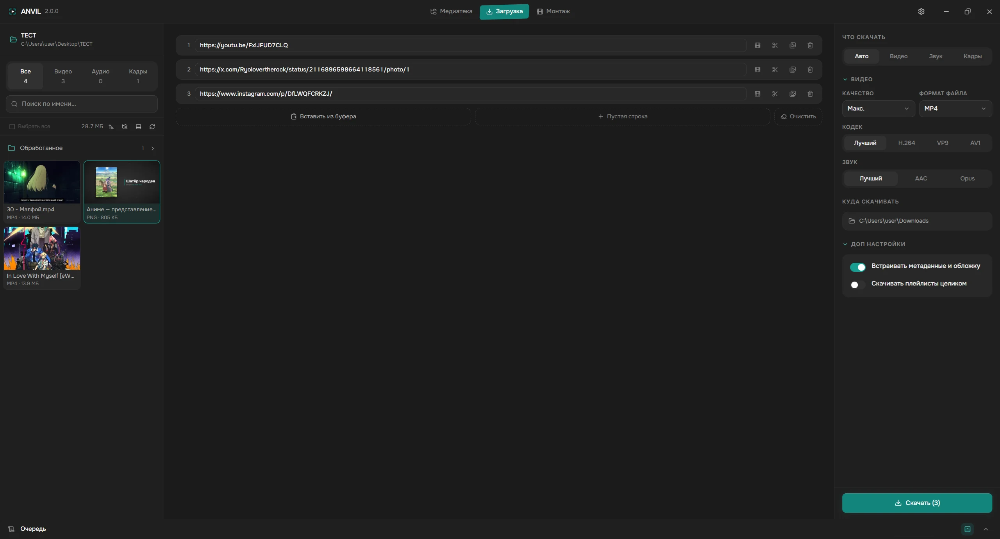
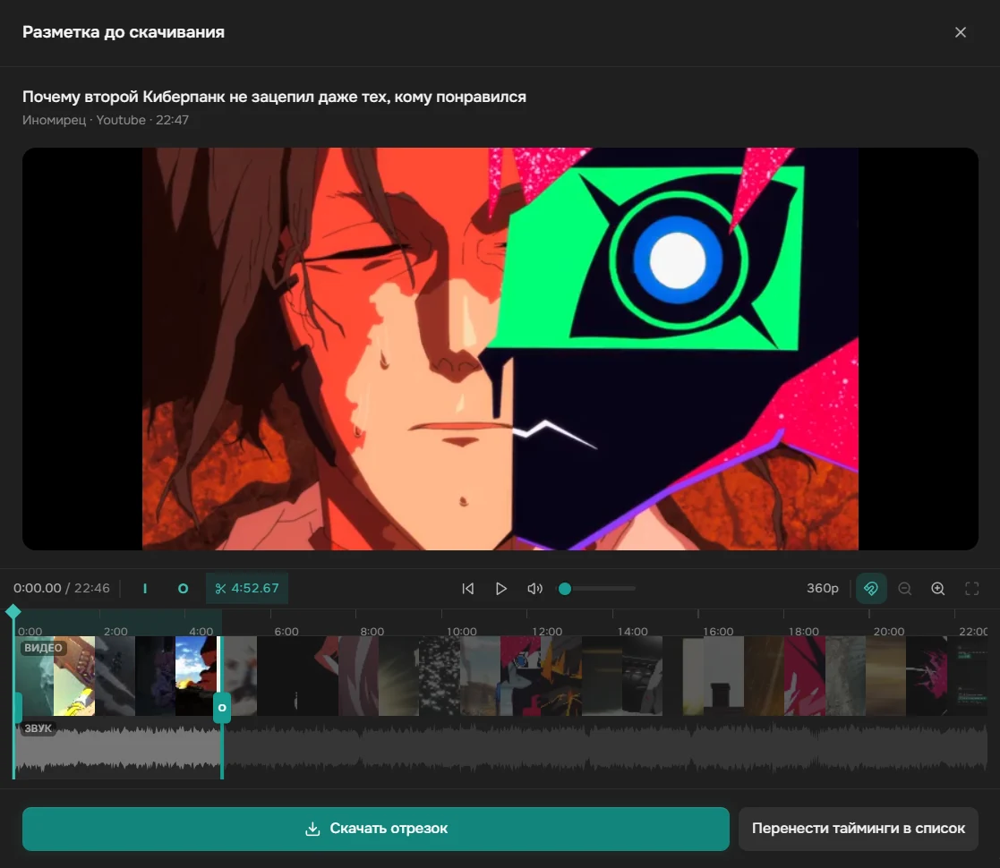
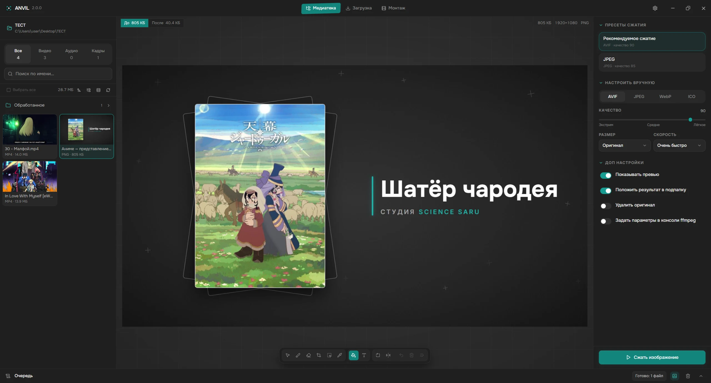
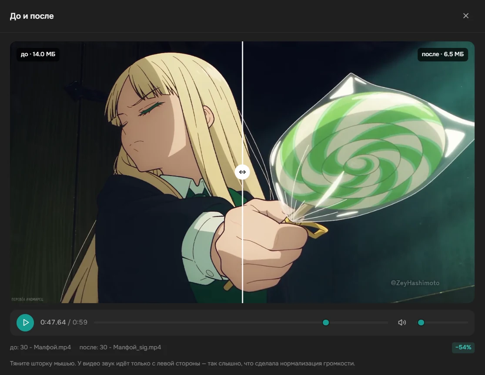
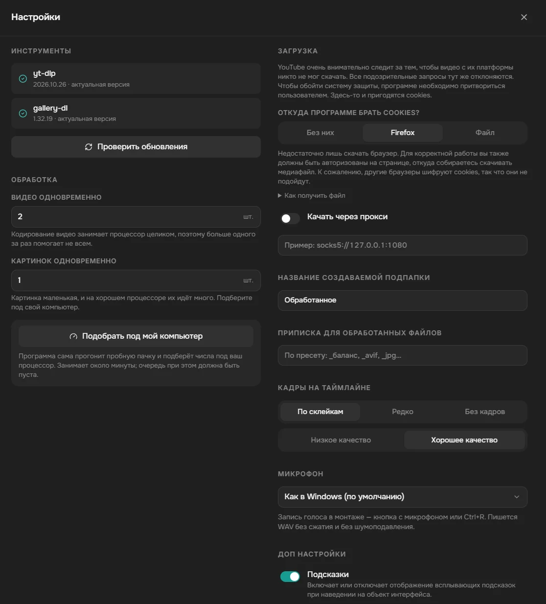
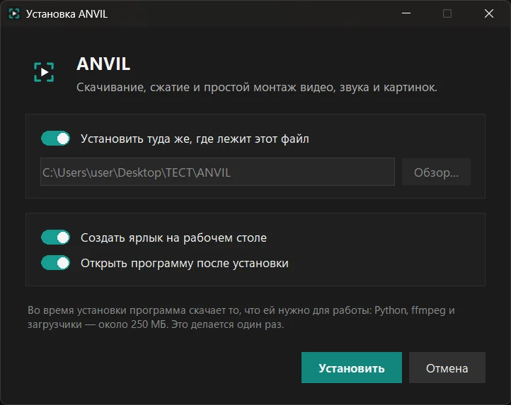

# SiGame Helper

Локальный «комбайн» для подготовки медиа к паками SIGame / SIQuester: скачать,
нарезать, смонтировать, сжать — в одном окне.

Сама игра принимает пак до 150 МБ, а каталог SIBrowser, через который паками
обычно делятся, — до 100 МБ. Без сжатия этот запас расходуется за несколько
вопросов. Приложение решает всю цепочку: качает исходники по ссылке,
даёт вырезать нужный фрагмент или собрать ролик из нескольких кусков и отдаёт
результат в современных кодеках, которые весят в разы меньше.

 



---

## Что умеет

**Загрузка**
- Список ссылок с номерами: длинная ссылка переносится по строкам, но остаётся
  одной записью. Вставили десяток разом — они сами разложатся по строкам.
- **Разметка до скачивания**: кнопка «Разметить» открывает видео прямо в
  программе, вы ставите метки In/Out — и скачивается только этот отрезок,
  а не весь ролик. Тайминги можно и просто вписать руками.
- Видео и звук через `yt-dlp`, картинки из постов X/Twitter, Instagram, Reddit,
  Pixiv и десятков других сайтов — через `gallery-dl`.
- В посте несколько картинок? Показывается сетка с превью — отмечаете нужные.
- Скачанное можно сразу отправить в очередь сжатия выбранным пресетом.

**Медиатека и плеер**
- Плеер с таймлайном: **дорожка видео** с кадрами (каждая сцена начинается
  своей плиткой ровно у склейки) и **дорожка звука** с волной.
- Метки **In** / **Out**: тяните их мышью или ставьте клавишами `I` и `O`.
  Длина отрезка всегда видна на панели.
- Шаг ровно на кадр, прыжок к соседней склейке или метке, приближение
  таймлайна колесом — к игле, а не к курсору.
- **Затухания за уголок** дорожки: картинка и звук появляются и уходят
  плавно, и это видно и слышно прямо в плеере, ещё до обработки.
- Зацикленный просмотр отрезка (`L`), кадр приближается колесом.
- **«Сохранить кадр»** (`S`) — стоп-кадр в PNG, в исходном разрешении.
- Список файлов — строками с превью, плитками или таблицей. По подпапкам
  можно ходить, как в проводнике; есть сортировка, фильтры по типу и поиск.
- Файл можно **перетащить в окно** прямо из проводника.
- Удаление отправляет файл **в корзину**, а не стирает навсегда.
- Сравнение **«до и после»** шторкой — и для картинок, и для видео.

**Монтаж**
- Несколько видео- и звуковых дорожек: верхняя дорожка — верхний слой.
  Ролик ложится парой — картинка и его звук, — и они двигаются вместе.
- Разрез под иглой, группы, копирование и вставка клипов, отмена действий.
- **Переходы сами собой**: положили клип внахлёст на соседний — в месте
  наложения один плавно сменяет другой, и картинка, и звук.
- **Место и размер в кадре** — рамкой прямо в окне просмотра, с прилипанием
  к сетке, краям и середине кадра. «Картинка в картинке», обрезка, маски
  любой формы, отражение, поворот, «задом наперёд», скорость от ×0.25 до ×4.
- **Ключи**: положение, размер, обрезку, маску, прозрачность и настройки
  эффектов можно менять по ходу ролика, с выбором плавности перехода.
- **Надписи и заливки** — для субтитров, плашек и заставок: любой шрифт
  Windows, обводка, тень, подложка со скруглением.
- **Эффекты**: цветокоррекция, чёрно-белое, размытие, шумоподавление,
  пикселизация, хромакей, размытый фон под вертикальным роликом, удаление
  водяного знака, стабилизатор; для звука — усиление, подавление шума в
  голосе, выравнивание громкости, эхо.
- **Звук в децибелах**: громкость клипа и всей дорожки, панорама, общая
  громкость монтажа на шине с индикатором уровня.
- **Просмотр со звуком**: программа собирает кусок монтажа настоящим
  кодировщиком и играет его — то, что вы видите, и уйдёт в файл.
- Кадр 480p, 720p, 1080p или свой размер, формы 16:9, 4:3, 3:2, 1:1 и их
  вертикальные варианты, частота кадров от 23.976 до 60.
- Сборка в AV1, H.265 или H.264 — качеством или битрейтом, — а можно и
  одним звуком. Метки I и O задают, какой отрезок собрать.
- Монтажи сохраняются в «Мои проекты». Если файлы проекта переехали,
  программа покажет, каких нет, и найдёт остальные в новой папке.

**Сжатие видео**
- **AV1 (SVT-AV1)** по умолчанию — при том же качестве заметно легче H.264.
- Пресеты вместо настроек: «Баланс», «Экономия», «Качество», «H.264 Баланс»
  на случай старого клиента и «Без сжатия» — быстрый срез без перекодирования.
- Отдельный пресет **«Конвертация в H.264»** — не для пака, а чтобы
  перевести капризный файл в формат, который откроет любая программа.
  Качество на глаз не меняется.
- **Разрешение выбирается отдельно**: «оригинал», 4K, 1440p, 1080p, 720p или
  480p. Вверх ничего никогда не растягивается.
- Скорость сжатия и контейнер (MP4, MKV, WebM) — рядом с пресетами.
- Галочка **«Кодировать на видеокарте»** работает с любым пресетом. Появляется только
  если программа реально смогла закодировать кадр на вашем железе.
- **Несколько звуковых дорожек и субтитры** (серии, фильмы): выбирается одна
  дорожка или все; субтитры — внутрь файла или отдельным файлом рядом.
  Выбор применяется ко всей пачке, в каждом файле дорожка ищется по языку.
- **HDR переводится в обычный цвет**, чтобы видео не выглядело выцветшим.
- **GIF перегоняется в видео**: SIQuester считает GIF картинкой с пределом
  1 МБ, а видео того же движения весит в разы меньше.

**Сжатие звука**
- Пресеты «Баланс · Opus» и «Баланс · MP3», под ними — выбор кодека (Opus,
  AAC, MP3, FLAC) и битрейта.
- **Выровнять громкость** (чтобы одни вопросы не глушили другие), **в моно**
  (для речи) и **в стерео** (свести 5.1 фильма в два канала).

**Редактор и сжатие изображений**
- **Закраска** прямоугольником, **кисть и ластик** — для надписей дугой и
  наискось, **пипетка**, чтобы заплатка совпала с фоном.
- **Надписи** на картинке: шрифт, размер, цвет, обводка.
- **Обрезка**, **выделение рамкой** (всё, что попало, убирается одним
  `Delete`), приближение колесом, `Ctrl` + `Z`.
- **Живое превью сжатия**: двигаете ползунок — и сразу видите, во что
  превратится картинка и сколько она будет весить. Это не оценка,
  а настоящий сжатый файл.
- Пресеты «Рекомендуемое сжатие» (AVIF), «JPEG» для совместимости и «Архив»
  — плюс ручной режим с выбором формата (AVIF, JPEG, WebP), качества,
  размера и скорости.
- Движущиеся GIF, WebP и APNG не превращаются молча в стоп-кадр: программа
  спросит, перевести ли их в движущийся WebP.

**Для тех, кому мало пресетов**
- Галочка «Задать параметры в консоли ffmpeg» под настройками экспорта
  открывает готовую команду — её можно **править и запускать как есть**.

**Очередь**
- Все операции идут в фоне отдельными процессами `ffmpeg`, интерфейс не
  подвисает даже на длинном видео.
- Прогресс, журнал и отмена по каждой задаче; понятное объяснение, если
  что-то пошло не так.
- Пакетная обработка: отметили сотню файлов — обработались по очереди.
- Сколько задач идёт одновременно, программа может подобрать сама под ваш
  компьютер: кнопка в настройках.

---

## Как это выглядит

**Загрузка по ссылкам.** Каждая ссылка — своя строка, к любой можно задать отрезок.



**Разметка до скачивания.** Видео открывается прямо в программе, вы ставите метки —
и скачивается только нужный кусок, а не вся серия.



**Редактор изображений.** Закрасить бренд или надпись — прямоугольником, кистью
или цветом, взятым пипеткой с самой картинки. Справа считается живое превью:
видно и результат, и будущий вес.



**До и после.** Шторка показывает, что именно сделало сжатие. На скриншоте
74.1 МБ превратились в 718 КБ — и разницы не видно.



**Настройки.** То, что настраивают один раз: доступ к сайтам, которые не отдают
файлы кому попало, прокси, папка для результатов и обновление загрузчиков.



---

## Установка

Нужен один файл — **`SiGame Helper.exe`**. Взять его можно двумя способами:
со страницы [Releases](../../releases) отдельным файлом или из архива
**Code → Download ZIP**, где он лежит в распакованной папке.

Запустите его — и всё.



Откроется обычный установщик: спросит, куда ставить, нужен ли ярлык на
рабочем столе и открыть ли программу после установки. Всё остальное он
сделает сам — скачает Python, `ffmpeg`, `Deno` и загрузчики (около 250 МБ)
и покажет ход дела полосой прогресса.

По умолчанию программа ставится **туда, где лежит сам файл**: скачали его
на рабочий стол — там и появится папка «SiGame Helper», распаковали архив —
установится прямо в распакованную папку. Снимите галочку, если хотите
выбрать другое место.

Этот же файл потом и запускает программу: когда всё установлено, он просто
открывает её, без всяких окон. Отдельной запускалки нет — файл один.

Ставить заранее ничего не нужно, права администратора не требуются.
Программа переносная: настройки, проекты монтажа и журнал хранятся в папке
`data` внутри неё, поэтому удаляется она удалением своей папки.

> Windows может один раз показать синее окно «SmartScreen: неизвестный
> издатель» — так она встречает любую программу без платной подписи.
> Нажмите **«Подробнее» → «Выполнить в любом случае»**.

> Deno — движок JavaScript. Он нужен `yt-dlp`, чтобы решать защитные задачки
> YouTube: без него сайт отвечает «Sign in to confirm you're not a bot» или
> «The page needs to be reloaded» даже с правильными куками.

> Если хотите, чтобы программа пользовалась **вашим** ffmpeg — положите
> `ffmpeg.exe` и `ffprobe.exe` в папку `bin` внутри установленной папки.
> Только берите **полную** сборку (например,
> <https://www.gyan.dev/ffmpeg/builds/>): в ней есть кодеры `libsvtav1`,
> `libaom-av1` (для AVIF) и `libopus`, в урезанных их нет.

---

## Обновление загрузчиков

Сайты постоянно ломают парсеры, поэтому `yt-dlp` стоит обновлять примерно раз
в месяц: **Настройки → Проверить обновления**, и если рядом с `yt-dlp` или
`gallery-dl` появится кнопка «Обновить» — нажмите её.

С `ffmpeg` и Deno так делать не нужно: они не зависят от вёрстки сайтов
и не «протухают».

---

## Как этим пользоваться

1. Нажмите на название папки в левом верхнем углу и выберите рабочую папку —
   в неё попадёт всё скачанное и обработанное.
2. Вкладка **«Загрузка»**: вставьте ссылки. Нужен кусок из середины часового
   видео? Нажмите **«Разметить»** — ролик откроется прямо здесь, поставьте
   In/Out и качайте только его.
3. Вкладка **«Медиатека»**: кликните файл — откроется плеер с лентой кадров
   и звуковой волной.
4. Поставьте метки `I` и `O`, послушайте отрезок в цикле (`L`).
5. Справа выберите пресет и нажмите кнопку обработки.
6. Результат — в подпапке `Обработанное` рядом с исходником. Оригинал не
   трогается, если вы сами не отметили «Удалить оригинал» — и даже тогда он
   уходит в корзину.
7. В очереди внизу нажмите значок сравнения, чтобы посмотреть **«до и после»**.

Нужно собрать ролик из нескольких кусков, наложить надпись или музыку —
вкладка **«Монтаж»**: перетащите файлы из медиатеки или проводника на
дорожки, а настройки сборки и кнопка «Рендер» — справа.

**Плеер медиатеки**

| Клавиша | Действие |
| --- | --- |
| `Пробел` | Играть / пауза |
| `I` / `O` | Метка начала / конца |
| `L` | Зациклить выделенный отрезок |
| `S` | Сохранить текущий кадр картинкой |
| `←` `→` | На один кадр |
| `Shift` + `←` `→` | К соседней склейке или метке |
| `Ctrl` + `←` `→` | На 5 секунд |
| `M` | Выключить звук |
| `Home` / `End` | В начало / в конец |
| Колесо над дорожкой | Приблизить / отдалить к игле |

**Монтаж**

| Клавиша | Действие |
| --- | --- |
| `Пробел` | Просмотр / стоп |
| `S` | Разрезать клипы под иглой |
| `I` / `O` | Начало / конец отрезка для рендера |
| `G` / `U` | Сгруппировать / разгруппировать |
| `K` / `Shift` + `K` | Поставить / убрать ключ под иглой |
| `Ё` | Сжать дорожки, чтобы видеть все разом |
| `Delete` | Удалить выбранное |
| `Ctrl` + `C` / `X` / `V` | Копировать / вырезать / вставить |
| `Ctrl` + `Z` | Отменить |
| `Ctrl` + `A` | Выделить всё |

Остальное — в меню по правой кнопке на клипе: там же подписаны клавиши.

**Редактор картинок**

| Клавиша | Действие |
| --- | --- |
| `Ctrl` + `Z` | Отменить последнее действие |
| `Ctrl` + `A` | Выделить всё нарисованное |
| `Delete` | Удалить выделенное — одну маску или всё, что попало в рамку |
| `Escape` | Снять выделение |
| Колесо мыши | Приблизить к точке под курсором |
| Средняя кнопка или `Пробел` | Двигать приближённую картинку |
| Правая кнопка по маске | Поменять цвет или удалить |

---

## Про разметку до скачивания

Кнопка «Разметить» работает так: `yt-dlp` разбирает страницу и отдаёт прямую
ссылку на поток, а программа проигрывает его через себя — иначе браузер такой
поток не откроет из-за защиты чужого сайта.

Получается не везде. Проверено на живых ссылках:

| Площадка | Предпросмотр | Скачивание |
| --- | --- | --- |
| YouTube | да | да |
| VK Видео | да | да |
| Mail.ru | да | да |
| Sibnet | да | да |
| OK.ru | нет | нет — ошибка в самом `yt-dlp`, ждём исправления |
| Прямые ссылки на `.mp4` | да | да |

Если предпросмотр недоступен, программа предложит **скачать черновик 360p**.
Разметьте его в обычном редакторе, вернитесь на вкладку «Загрузка» и впишите
тайминги руками — финальный отрезок скачается в полном качестве. Тайминги можно
вписывать и сразу, не открывая предпросмотр: в формате `1:23` или просто `83`.

**А если дать ссылку не на плеер, а на страницу сайта?**

Для площадок, которые `yt-dlp` знает в лицо (YouTube, VK, Reddit, X, Instagram,
Imgur и ещё сотни), ссылка на пост или страницу работает — он сам найдёт там
медиа. Для остальных сайтов он просматривает HTML страницы в поисках
видео. Если плеер подставляется скриптом уже в браузере — а так устроено
большинство аниме-сайтов, — находить нечего, и вы получите «Unsupported URL».
В таком случае попробуйте ссылку из самого плеера, а не на страницу.

Крупные сайты проверяют, что запрос идёт из настоящего браузера с вошедшим
пользователем. Без такого подтверждения часть роликов не скачается вовсе,
а возрастные и закрытые — тем более. Настраивается это в «Настройках»,
раздел **«Доступ к сайтам»**, двумя способами:

- **Из Firefox** — программа сама прочитает его хранилище. Ничего ставить
  не нужно, но Firefox должен стоять, и в нём нужно быть авторизованным.
- **Файлом** — подойдёт любому браузеру. Бесплатное расширение
  **Get cookies.txt LOCALLY** сохраняет файл `cookies.txt`, который вы
  выбираете в программе. Ссылки на расширение есть прямо в настройках,
  искать вручную не нужно. Кнопка «Проверить» спросит у YouTube, принимает
  ли он эти куки.

Chrome, Edge, Opera и Vivaldi прочитать напрямую нельзя — они шифруют своё
хранилище. Для них годится только второй способ.

---

## Про кодеки

По умолчанию видео жмётся в **AV1 + Opus** в контейнере MP4. Это самый
экономный вариант, и современные версии SIGame его проигрывают.

Если у кого-то из компании старый клиент, который спотыкается на AV1 —
возьмите пресет **«H.264 Баланс»**: этот кодек понимает вообще всё,
но при том же качестве файлы примерно в полтора-два раза тяжелее.

**SIQuester не показывает AV1** в своём предпросмотре, хотя сама игра его
проигрывает: это ограничение редактора пака, а не испорченный файл.

Пресет «Без сжатия» копирует поток как есть, поэтому работает мгновенно, но
границы отрезка сдвигаются к ближайшим ключевым кадрам — иногда на несколько
секунд. Для точной нарезки нужно перекодирование.

**Насколько сожмётся файл, зависит от исходника, а не от пресета.** Уже
сжатое AV1-видео похудеет примерно в полтора раза, H.264 с высоким битрейтом
— раз в пять, а «сырая» запись экрана — в десятки раз.

---

## Устройство проекта

```
backend/                Сервер на FastAPI
  app/
    core/
      binaries.py       Поиск ffmpeg / yt-dlp / gallery-dl
      encode.py         Сборка команд ffmpeg (чистая логика, без запуска)
      images.py         Сжатие картинок
      compose.py        Монтаж: таймлайн -> команда ffmpeg
      effects.py        Эффекты и маски монтажа
      anim.py           Ключи: значения по ходу клипа
      stabilize.py      Стабилизатор (ровная копия ролика в фоне)
      scenes.py         Поиск склеек и лента кадров по сценам
      fonts.py          Шрифты Windows для надписей
      download.py       Обёртки над yt-dlp и gallery-dl
      jobs.py           Очередь фоновых задач и пулы исполнителей
      pipeline.py       Связка запросов API с задачами
      failures.py       Понятные объяснения ошибок
      benchmark.py      Подбор числа одновременных задач
      probe.py          Чтение характеристик файлов через ffprobe
      waveform.py       Звуковая волна для таймлайна (с кэшем)
      filmstrip.py      Лента кадров для видеодорожки (с кэшем)
      streamproxy.py    Предпросмотр чужого видео до скачивания
      toolchain.py      Автоустановка ffmpeg и Deno
      thumbs.py         Миниатюры для медиатеки
      presets.py        Каталог пресетов
      trash.py          Удаление файлов в корзину Windows
      titlebar.py       Своя строка заголовка окна
      certs.py          Корневые сертификаты и соединение только по IPv4
      updates.py        Проверка обновлений загрузчиков
      events.py         Шина событий (SSE)
    routers/            HTTP-эндпоинты
    main.py             Сборка приложения
  run.py                Точка входа: сервер + окно или браузер
frontend/               React + Vite + Tailwind
  src/components/       Медиатека, плеер, монтаж, редактор картинок, очередь
  src/lib/              Клиент API, типы, форматирование
installer.py            Установщик и запускалка в одном файле
scripts/
  build.bat             Сборка фронтенда в backend/app/static
  build-exe.bat         Сборка SiGame Helper.exe
  dev.bat               Режим разработки: сервер + Vite с горячей перезагрузкой
  reveal.ps1            Показ файла в проводнике
runtime/                Переносимый Python (появляется при установке)
bin/                    ffmpeg, ffprobe, Deno (появляются при установке)
data/                   Настройки, проекты монтажа, кэш и журнал
```

Сервер слушает только `127.0.0.1` и принимает запросы только из окна самой
программы: страницы, открытые в браузере, до него не достают.

## Разработка

Для разработки удобнее обычное виртуальное окружение — если рядом с проектом
есть папка `.venv`, `SiGame Helper.exe` возьмёт её вместо `runtime`
и установку предлагать не станет:

```bat
python -m venv .venv
.venv\Scripts\python.exe -m pip install -r backend\requirements.txt
```

Нужен Node.js 18+ и Python 3.11+.

```bat
scripts\dev.bat
```

Поднимает бэкенд на `127.0.0.1:8756` и Vite с горячей перезагрузкой на
`127.0.0.1:5173`. Работать нужно на 5173 — запросы к `/api` уходят на бэкенд
через прокси.

Собрать фронтенд в продакшн (кладётся прямо внутрь бэкенда):

```bat
scripts\build.bat
```

Собрать `.exe` (после сборки фронтенда):

```bat
scripts\build-exe.bat
```

Порядок важен: если собрать `.exe` раньше фронтенда, внутрь попадёт старый
интерфейс.

---

## Благодарности

Идея этой программы выросла из **[SI-HYX](https://github.com/GoldensFire/SI-HYX)**
от [GoldensFire](https://github.com/GoldensFire). Оттуда же взято главное про
сжатие для паков: AV1 вместо H.264, Opus вместо MP3, выравнивание громкости по
EBU R128, AVIF для картинок. Загляните и в оригинал — у него свой подход
к той же задаче.


## Лицензия

MIT — делайте что хотите.

`ffmpeg`, `yt-dlp` и `gallery-dl` распространяются по собственным лицензиям и в
состав проекта не входят.
